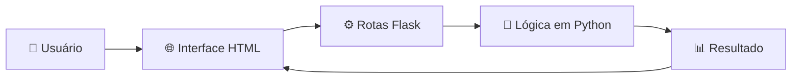

<div align="center">

# 🧬 EVOLUÇÃO FLASK

**[Slogan ou descrição curta do projeto em uma frase]**


[📖 Sobre](#-sobre-o-projeto) •
[✨ Funcionalidades](#-funcionalidades) •
[🚀 Como executar](#-como-executar) •
[📂 Estrutura](#-estrutura-do-projeto) •
[👩‍💻 Autora](#-autora)

</div>

---

## 📖 Sobre o projeto

[Explique o que o projeto faz, qual problema resolve e por que foi criado.]

<div align="center">


*[Legenda da imagem: tela principal da aplicação]*

</div>

---

## ✨ Funcionalidades

| | Funcionalidade | Descrição |
|---|---|---|
| 🔹 | [Funcionalidade 1] | [O que ela faz] |
| 🔹 | [Funcionalidade 2] | [O que ela faz] |
| 🔹 | [Funcionalidade 3] | [O que ela faz] |

---

## 🔄 Fluxo da aplicação



---

## 🛠️ Tecnologias

| Tecnologia | Uso |
|---|---|
| 🐍 **Python** | Linguagem principal |
| 🌶️ **Flask** | Framework web |
| 🎨 **HTML / CSS** | Interface |
| [📦 Outra lib] | [Para que é usada] |

---

## 🚀 Como executar

### Pré-requisitos

- [Python 3.8+](https://www.python.org/downloads/)
- [Git](https://git-scm.com/)

### Passo a passo

```bash
# 1️⃣ Clone o repositório
git clone https://github.com/julianabcor/EVOLUCAO-FLASK.git
cd EVOLUCAO-FLASK

# 2️⃣ Crie e ative o ambiente virtual
python -m venv venv
source venv/bin/activate        # Linux/macOS
venv\Scripts\activate           # Windows

# 3️⃣ Instale as dependências
pip install -r requirements.txt

# 4️⃣ Execute a aplicação
flask run
```

Depois é só abrir 👉 **http://127.0.0.1:5000**

---

## 📂 Estrutura do projeto

```
📦 EVOLUCAO-FLASK
 ┣ 📂 static          # CSS, JS e imagens
 ┣ 📂 templates       # Páginas HTML
 ┣ 📜 app.py          # Aplicação principal
 ┣ 📜 requirements.txt
 ┗ 📜 README.md
```

---

## 🗺️ Roadmap

- [x] Estrutura inicial com Flask
- [ ] [Próxima funcionalidade]
- [ ] [Melhoria futura]
- [ ] Deploy online

---

## 🤝 Contribuindo

Contribuições são bem-vindas!

1. Faça um fork do projeto
2. Crie uma branch: `git checkout -b minha-feature`
3. Commit: `git commit -m "Adiciona minha feature"`
4. Push: `git push origin minha-feature`
5. Abra um Pull Request

---

## 👩‍💻 Autora

<div align="center">

Feito com 💜 por **Juliana**

[](https://github.com/julianabcor)

⭐ Se gostou do projeto, deixe uma estrela!

</div>
